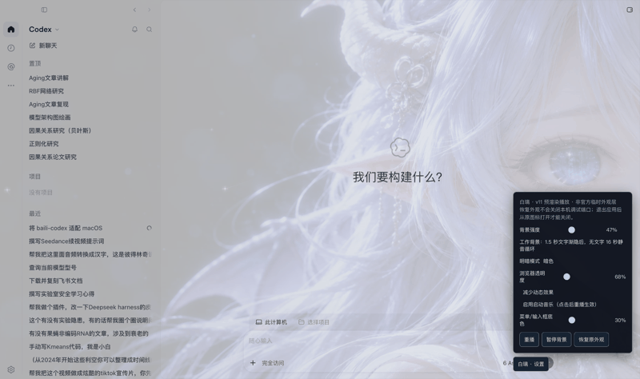

# 白璃 · Codex macOS 动态背景

**[⬇ 下载白璃流光 v1.3.7 · Apple 芯片 Mac（约 79 MB）](https://github.com/surunlang-creator/baili-codex-macos/releases/download/1.3.7/Codex-Baili-Glow-v1.3.6-shared-library-8pets-arm64.zip)**

[本版 Release](https://github.com/surunlang-creator/baili-codex-macos/releases/tag/1.3.7) · [全部版本](https://github.com/surunlang-creator/baili-codex-macos/releases)

> 安装 App 请点上方下载按钮。GitHub 的 **Code → Download ZIP** 用于下载仓库源码。

白璃流光为 macOS 上的 Codex 加入开场动画、动态壁纸、音乐播放器和互动桌宠。你可以为开场和工作背景分别选素材，也可以在聊天输入框旁打开流光设置。

## v1.3.7 · 八只萌宠

本版基于 v1.3.6 共享素材库版制作，保留原有 6 只宠物，新增两只可独立启用的 Claude 桌宠：

- **Claude · 银紫龙娘**：银紫长发、白色龙角与紫色龙翼。
- **Claude · 全身原画**：铜橙长发、向日葵发饰与刺绣短裙。

两只新宠物各有 11 组动作。进入完整流光界面后，按 **Control + Option + G** 打开「流光设置 → 萌宠」，点选宠物卡片即可启用，也可以同时选择多只。

## 安装与启动

1. 准备一台 **Apple 芯片 Mac**，安装 **Node.js 22.3 或更高版本**和官方 ChatGPT/Codex 客户端。启动器默认从 `/Applications/ChatGPT.app` 查找客户端。
2. 下载并解压上方安装包，把 **Codex · 白璃流光.app** 拖入「应用程序」。
3. 保存当前工作，按 **⌘Q** 完全退出官方客户端，再双击 **Codex · 白璃流光**，进入完整模式。

如果官方客户端已经运行，点击白璃会将已有窗口带到前台。需要加载完整流光界面时，请按第 3 步重新启动。

## 常用操作

| 想做什么 | 从哪里操作 |
| --- | --- |
| 更换下次开场动画 | 菜单栏月亮 →「下次开场动画」，选择白璃或淡紫龙娘 |
| 更换工作背景 | 打开「素材库」，点击图片或视频卡片。当前选择会保存，下次启动继续使用，与开场动画独立 |
| 调整背景或浏览器透明度 | **Control + Option + B** →「白璃设置」 |
| 调整输入框流光、滑块或桌宠 | **Control + Option + G** →「流光设置」 |
| 播放本地音乐 | 素材库中添加曲目，点击播放。支持拖动进度、调整音量，以及顺序、单曲循环或随机播放 |

工作背景默认不透明度为 **22%**。导入普通 MP4/MOV 背景时，播放器默认使用无音轨副本，主动开启背景声音后才使用原视频。分段 MP4 暂不支持，具体视频编码仍取决于客户端的解码能力。

## 使用与数据

白璃流光是非官方外观启动器，保留官方 App 文件。安装包采用本地临时签名，尚未经过 Apple 公证。

完整模式会为已登录的客户端开启本机调试端口，同一台 Mac 上的其他程序可能通过该端口访问客户端。要关闭端口，请按 **⌘Q** 完全退出官方客户端。

导入工作素材库的图片、视频和音乐保存在本机 IndexedDB。清理客户端数据目录可能导致素材丢失。无音轨副本用于静音播放，文件中仍可能保留原始音频字节。AirPods 自动切换行为尚未经过实机验证。

## 来源与许可

白璃动画基于 [chenyi380/baili-codex](https://github.com/chenyi380/baili-codex)。淡紫龙娘开场与循环素材来自 [wynneceles/ai-boot-animations](https://github.com/wynneceles/ai-boot-animations/tree/main/codex)，其作者享有权利的部分采用 [CC BY-NC-ND 4.0](https://creativecommons.org/licenses/by-nc-nd/4.0/deed.zh-hans) 许可。输入框流光基于 [yicun0316/dsh-claude-slider](https://github.com/yicun0316/dsh-claude-slider)。

各部分代码、动画、音乐和角色素材适用各自的许可与署名要求。详见 [LICENSE](LICENSE)、[ASSET-NOTICE.md](ASSET-NOTICE.md)、[NOTICE.md](NOTICE.md) 及 App 内附的第三方声明。
